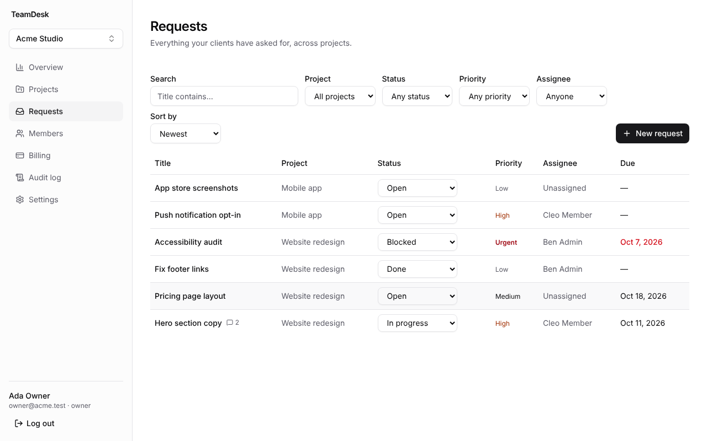
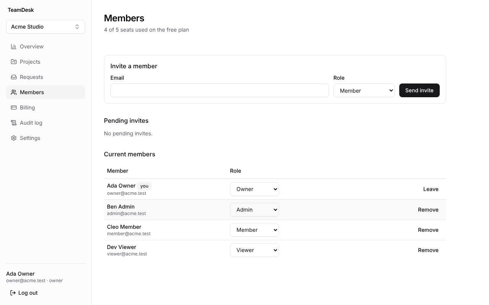
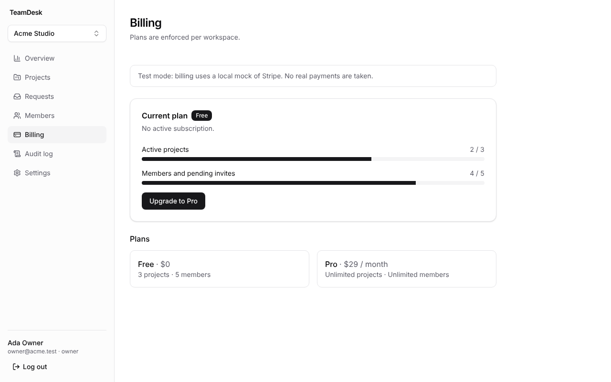
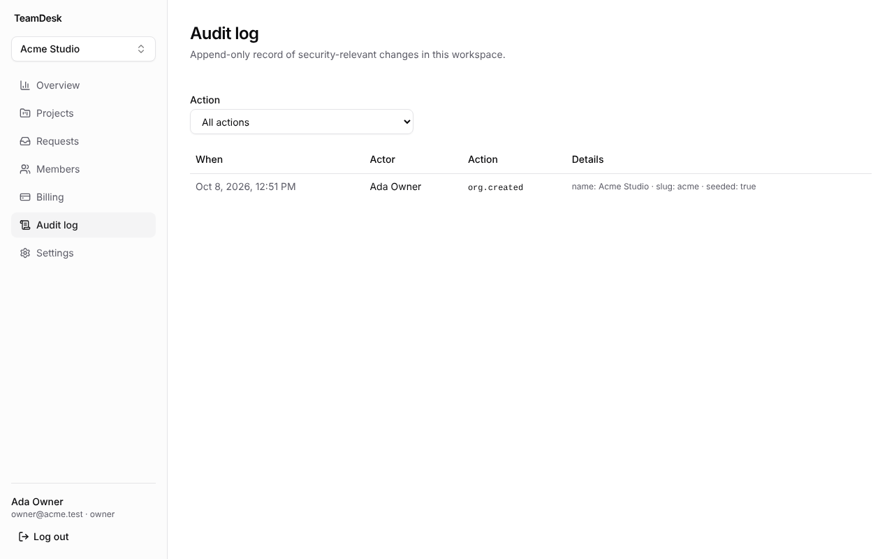
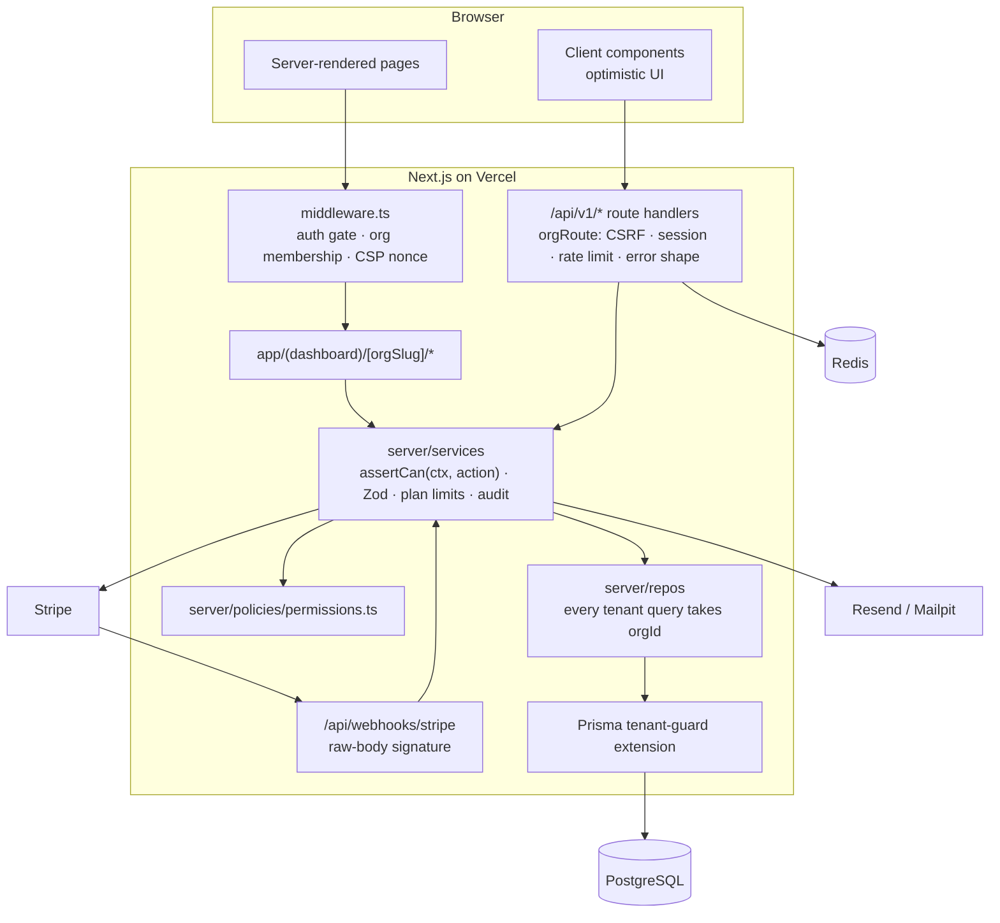

# TeamDesk

**Multi-tenant SaaS for agencies: track projects and client requests per workspace, invite your team,
give clients read-only access, and bill per workspace with Stripe.**


-95%25-brightgreen>)


- **Live demo:** _coming soon — `https://teamdesk-demo.vercel.app` (placeholder)_
- **Demo logins** (demo deployment, reset nightly): `owner@demo.teamdesk.dev` (owner) ·
  `viewer@demo.teamdesk.dev` (read-only) — password `demo-password-123`

> 🎬 **Walkthrough GIF:** _placeholder — to be recorded on the deployed demo._

| Requests (filters, inline status)     | Members & invites                   |
| ------------------------------------- | ----------------------------------- |
|  |  |
| **Billing (plan limits, Stripe)**     | **Append-only audit log**           |
|    |  |

## Features

- **Workspaces (tenants):** created at sign-up, unique URL slugs, workspace switcher, rename / change URL.
- **Auth:** email + password (argon2id) with email verification and password reset, Google OAuth, rate-limited
  login, sessions revoked on password reset.
- **Team:** invites (hashed single-use tokens, 7-day expiry, resend/revoke), roles OWNER / ADMIN / MEMBER / VIEWER,
  last-owner protection.
- **Product:** projects (archive/unarchive), requests with status, priority, assignee and due date, comments;
  filters, sorting and cursor pagination; optimistic updates.
- **Billing:** FREE (3 projects, 5 seats) and PRO (unlimited) enforced server-side; Stripe Checkout + Customer
  Portal; idempotent, order-safe webhooks; local mock mode that needs no Stripe account.
- **Hardening:** append-only audit log (ADMIN+), nonce-based CSP + security headers, CSRF origin checks, Redis
  rate limits, structured logs with request ids, Sentry, `/api/health`.
- **REST API** under `/api/v1` (23 route files, 30 handlers) with a consistent error shape.

## Architecture



**Tenant isolation is layered** (ADR 0001): middleware membership check → `OrgContext` + permission check in every
service → repositories that require `orgId` → a Prisma extension that throws if a tenant model is queried without
`organizationId` (and makes `AuditLog` append-only, backed by a Postgres trigger). Another tenant's resources return
**404**, never 403.

## Tech decisions

| Decision                                         | Why                                                         | Record                                           |
| ------------------------------------------------ | ----------------------------------------------------------- | ------------------------------------------------ |
| Shared schema + `organizationId`                 | Cheapest onboarding and ops; isolation enforced in 4 layers | [ADR 0001](docs/adr/0001-tenancy-model.md)       |
| Auth.js v5, JWT sessions + `sessionVersion`      | Credentials + OAuth on App Router; revocable JWTs           | [ADR 0002](docs/adr/0002-auth.md)                |
| Webhook ledger in the same transaction           | Replays are no-ops, crashes are retried, order-safe         | [ADR 0003](docs/adr/0003-webhook-idempotency.md) |
| One permission map                               | Single source of truth, matrix-tested                       | [ADR 0004](docs/adr/0004-permissions.md)         |
| Pinned versions (Next 15.5, Prisma 6, TS 5.9, …) | Stable APIs; reasons per package                            | [ADR 0005](docs/adr/0005-dependency-versions.md) |

## Run it locally (3 commands)

Requires Node 22, pnpm 10 and Docker.

```bash
cp .env.example .env && docker compose up -d   # Postgres 16, Redis 7, Mailpit
pnpm i && pnpm db:migrate && pnpm db:seed       # installs, migrates, seeds demo data
pnpm dev                                         # http://localhost:3000
```

Seeded logins (password `teamdesk-dev-123`): `owner@acme.test`, `admin@acme.test`, `member@acme.test`,
`viewer@acme.test` (Acme Studio); `admin@acme.test` also owns Globex Agency. Emails (verification, reset, invites)
land in Mailpit at http://localhost:8025. Billing runs in mock mode by default — see below for real Stripe.

## Testing

| Suite                  | Command                                              | What it covers                                                                                   |
| ---------------------- | ---------------------------------------------------- | ------------------------------------------------------------------------------------------------ |
| Lint / types / format  | `pnpm lint` · `pnpm typecheck` · `pnpm format:check` | type-aware ESLint (no `any`, Prisma imports only in repos)                                       |
| Unit (140 tests)       | `pnpm test`                                          | tenant guard, full permission matrix, services with mocked repos, components (Testing Library)   |
| Integration (80 tests) | `pnpm test:integration`                              | services + route handlers on real Postgres/Redis, incl. cross-tenant 404s, plan limits, webhooks |
| Coverage               | `pnpm test:coverage`                                 | unit + integration over `server/**` — 95.1% lines, 93.3% branches (gate: 80%)                    |
| E2E (8 tests)          | `pnpm build && pnpm test:e2e`                        | sign-up → verify (Mailpit) → invite → accept in 2nd browser → upgrade; viewer read-only; CSP     |

Integration tests use a separate `teamdesk_test` database (`TEST_DATABASE_URL`), recreated per run.

## Testing billing locally with the Stripe CLI

By default (`BILLING_MODE=mock`) no Stripe account is needed: "Upgrade to Pro" opens a local test checkout that
creates **signed** fake events and runs them through the webhook's own signature check and idempotent handler.

To test against real Stripe (test mode):

1. Create a product with a monthly price in the Stripe dashboard (test mode) and copy its `price_…` id.
2. In `.env`: `BILLING_MODE=live`, `STRIPE_SECRET_KEY=sk_test_…`, `STRIPE_PRO_PRICE_ID=price_…`.
3. Forward webhooks and copy the printed signing secret into `STRIPE_WEBHOOK_SECRET`:
   ```bash
   stripe login
   stripe listen --forward-to localhost:3000/api/webhooks/stripe \
     --events checkout.session.completed,customer.subscription.created,customer.subscription.updated,customer.subscription.deleted,invoice.payment_failed
   ```
4. `pnpm dev`, open Billing → Upgrade to Pro, pay with `4242 4242 4242 4242`.
5. Replay or simulate events:
   ```bash
   stripe events resend evt_…                 # same event twice → state changes once
   stripe trigger invoice.payment_failed      # → subscription past_due, audit entry
   ```
6. Enable the Customer Portal (Settings → Billing → Customer portal) to use "Manage billing".

## API

All endpoints live under `/api/v1`, authenticate with the session cookie, and return
`{ data }` / `{ data, nextCursor }` or `{ error: { code, message, details } }` with 400 / 401 / 403 / 404 / 409 / 422 / 429.

```
GET|POST   /orgs                                  GET|PATCH /orgs/:slug
GET|POST   /orgs/:slug/projects                   GET|PATCH /orgs/:slug/projects/:id
GET|POST   /orgs/:slug/requests?status=&priority=&assignee=&projectId=&q=&sort=&order=&cursor=&limit=
GET|PATCH|DELETE /orgs/:slug/requests/:id         GET|POST  /orgs/:slug/requests/:id/comments
DELETE     /orgs/:slug/comments/:id               GET       /orgs/:slug/assignees
GET        /orgs/:slug/members                    PATCH|DELETE /orgs/:slug/members/:id
GET|POST   /orgs/:slug/invites                    DELETE /orgs/:slug/invites/:id · POST …/:id/resend
POST       /invites/:token/accept                 GET /orgs/:slug/audit?action=&cursor=
GET        /orgs/:slug/billing                    POST /orgs/:slug/billing/checkout · POST …/portal
```

## Deploy

Vercel + Neon + Upstash + Resend + Stripe; `prisma migrate deploy` runs in the release (build) step, never on app
start. Full guide: [docs/DEPLOYMENT.md](docs/DEPLOYMENT.md).

## Project docs

[Build plan](docs/PLAN.md) · [Known gaps / TODO](docs/TODO.md) · [Case study](docs/CASE_STUDY.md) ·
[Lighthouse results](docs/LIGHTHOUSE.md) · [Contributor guide](CLAUDE.md)

## Roadmap

- **SSO** (SAML/OIDC per workspace) for larger clients.
- **Postgres Row-Level Security** as a DB-enforced fifth isolation layer.
- **Public API** with per-workspace API keys (the `ApiKey` model already exists).
- **Outgoing webhooks** so clients can sync request changes into their own tools.
