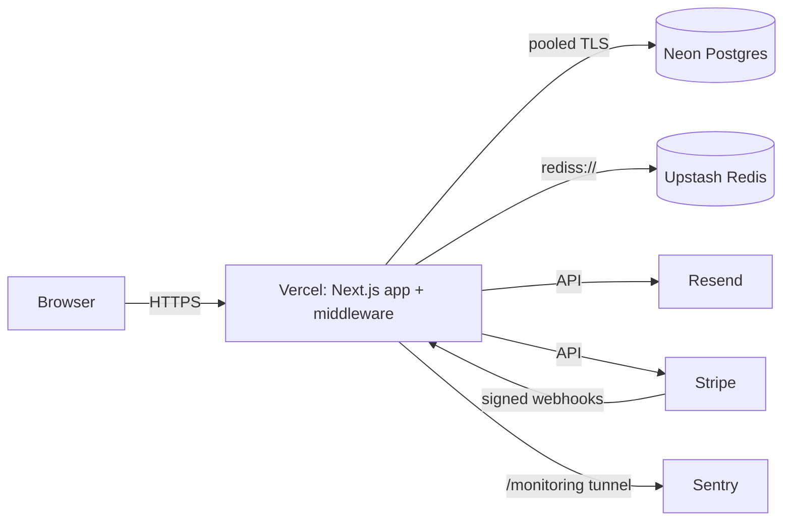

# Deployment: Vercel + Neon + Upstash + Resend + Stripe

## 1. Create the services

| Service                      | What to create                                                                                                                                                                                                                                                                                                | Variables it gives you                                                                      |
| ---------------------------- | ------------------------------------------------------------------------------------------------------------------------------------------------------------------------------------------------------------------------------------------------------------------------------------------------------------- | ------------------------------------------------------------------------------------------- |
| **Neon**                     | Project (Postgres 16) + `main` branch. Enable the Neon ↔ Vercel integration to get a DB branch per preview.                                                                                                                                                                                                   | Pooled URL → `DATABASE_URL`; direct URL → `DIRECT_DATABASE_URL`                             |
| **Upstash**                  | Redis database (same region as Vercel functions). Use the **TCP/TLS** URL, not REST.                                                                                                                                                                                                                          | `REDIS_URL=rediss://default:…@….upstash.io:6379`                                            |
| **Resend**                   | Verify your sending domain (SPF/DKIM DNS records), create an API key.                                                                                                                                                                                                                                         | `RESEND_API_KEY`, `EMAIL_FROM="TeamDesk <no-reply@yourdomain>"`                             |
| **Stripe** (test mode first) | Product "TeamDesk Pro" with a monthly price; enable the Customer Portal; add a webhook endpoint `https://<domain>/api/webhooks/stripe` with events `checkout.session.completed`, `customer.subscription.created`, `customer.subscription.updated`, `customer.subscription.deleted`, `invoice.payment_failed`. | `STRIPE_SECRET_KEY`, `STRIPE_PRO_PRICE_ID`, `STRIPE_WEBHOOK_SECRET`                         |
| **Google Cloud** (optional)  | OAuth client (Web). Authorised redirect URI: `https://<domain>/api/auth/callback/google`.                                                                                                                                                                                                                     | `AUTH_GOOGLE_ID`, `AUTH_GOOGLE_SECRET`                                                      |
| **Sentry** (optional)        | Next.js project; an auth token with `project:releases` for source maps.                                                                                                                                                                                                                                       | `SENTRY_DSN`, `NEXT_PUBLIC_SENTRY_DSN`, `SENTRY_AUTH_TOKEN`, `SENTRY_ORG`, `SENTRY_PROJECT` |

## 2. Configure Vercel

1. Import the GitHub repo. Framework preset: Next.js. Node 22.
2. **Build command:** `pnpm db:deploy && pnpm build`
   - `prisma migrate deploy` runs as the release step of each deployment, **never at app start**.
     It only applies committed migrations and takes an advisory lock, so concurrent builds are safe.
   - With the Neon integration, previews migrate their own DB branch; production migrates `main`.
   - Prefer gated releases? Run `pnpm db:deploy` in a GitHub Actions job before `vercel deploy --prebuilt`
     instead, and set the build command back to `pnpm build`.
3. **Environment variables** (Production and Preview):

   | Variable                                                            | Value                                                       |
   | ------------------------------------------------------------------- | ----------------------------------------------------------- |
   | `APP_URL`                                                           | `https://<your-domain>`                                     |
   | `AUTH_SECRET`                                                       | `openssl rand -base64 32`                                   |
   | `AUTH_TRUST_HOST`                                                   | `true`                                                      |
   | `DATABASE_URL`, `DIRECT_DATABASE_URL`                               | from Neon (set automatically by the integration)            |
   | `REDIS_URL`                                                         | from Upstash                                                |
   | `RESEND_API_KEY`, `EMAIL_FROM`                                      | from Resend                                                 |
   | `BILLING_MODE`                                                      | `live` (the app refuses to start in production with `mock`) |
   | `STRIPE_SECRET_KEY`, `STRIPE_WEBHOOK_SECRET`, `STRIPE_PRO_PRICE_ID` | from Stripe                                                 |
   | `AUTH_GOOGLE_ID`, `AUTH_GOOGLE_SECRET`                              | optional                                                    |
   | `SENTRY_*`, `NEXT_PUBLIC_SENTRY_DSN`                                | optional                                                    |
   | `LOG_LEVEL`                                                         | `info`                                                      |
   | `DEMO_MODE`                                                         | `true` only on the public demo deployment                   |

   Never set `ALLOW_MOCK_BILLING` or `SKIP_ENV_VALIDATION` on Vercel.

4. Deploy. Check `https://<domain>/api/health` returns `{"status":"ok"}` (DB + Redis).

## 3. After the first deploy

- Stripe: send a test event from the dashboard to the webhook endpoint → expect HTTP 200 and an entry in
  the workspace audit log after a real checkout.
- Point an uptime monitor at `/api/health` (503 = degraded dependency).
- Production data is never seeded. For the public demo, use a separate Vercel project + Neon branch with
  `DEMO_MODE=true`, run `pnpm db:seed` once, and enable the nightly reset:
  set the repo variable `DEMO_ENABLED=true` and secret `DEMO_DATABASE_URL` (see `.github/workflows/demo-reset.yml`).

## Rollback

Vercel "Promote previous deployment" rolls back code instantly. Migrations are forward-only: write
backwards-compatible (expand → migrate → contract) migrations so the previous build keeps working against
the new schema.
